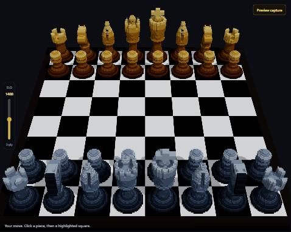
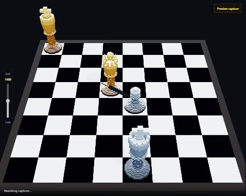
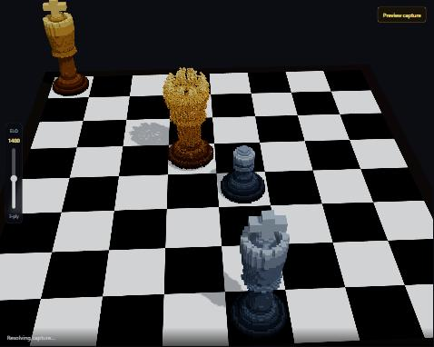

# Voxel Chess

A chess engine with a verified move generator, and a 3D board to play it on.
Every piece, weapon and effect is generated in code — no imported models, and
nothing fetched at runtime, so the desktop build works offline.



The engine is the point. Its move generation is checked against published
**perft** node counts, which are identical for every correct engine: the
initial position has exactly 197,281 legal continuations at depth 4. Matching
them is strong evidence the generator is right, and failing to is proof that
it is not.

| | |
|---|---|
|  |  |
| Each piece brings its own weapon | Captured pieces come apart into their own voxels |

---

## Running it

```bash
npm install
npm run dev
```

Then open the address Vite prints (`http://localhost:5173` by default).

### Desktop

Prebuilt Windows binaries — an installer and a standalone executable — are
attached to the [Releases](../../releases) page. Neither is code-signed, so
SmartScreen will warn on first run.

To build it yourself:

```bash
npm run tauri build
```

This needs the Rust toolchain and, on Windows, MSVC. See
[`docs/BUILDING.md`](docs/BUILDING.md) for a toolchain trap worth knowing
about before you spend an afternoon on it.

## Playing

You are white; the engine plays black in a Web Worker, so the board keeps
rendering while it thinks.

- **Click a piece**, then click one of the highlighted squares.
- **Drag** to orbit, **scroll** to zoom.
- **Preview capture** cycles six staged positions, one per attacking piece, so
  you can see all six weapons without playing a game into the right shape.
- **Engine strength** is the vertical slider on the left. It sets a time
  budget, a ceiling on search depth, a blunder rate, and whether the engine
  reliably knows castling and en passant at all — below 800 it mostly
  stumbles into them, so weak play reads as inexperience rather than as a
  smaller budget.

The engine deepens iteratively against that budget and answers from the last
pass that finished, so how long it thinks is a promise rather than a property
of the position. Measured on a middlegame position, worst of five runs:

| strength | budget | depth cap | depth reached | worst observed |
|---|---|---|---|---|
| 600 | 60 ms | 1 | 1 | 9 ms |
| 1000 | 100 ms | 2 | 2 | 59 ms |
| 1400 | 440 ms | 7 | pending re-measurement | — |
| 1800 | 1250 ms | 8 | 3 | 1260 ms |
| 2200 | 1700 ms | 9 | 3 | 1711 ms |

Overshoot is 10–11 ms at the top, which is the deadline sampling interval
doing its job. Note that the depth *caps* are not the binding constraint —
the three strongest settings all run out of budget at three plies. The cap
only matters in sparse endgames where the tree is small enough to exhaust.

`test/search-budget.test.ts` enforces those bounds, because a latency claim
nobody measures goes stale the first time somebody adds a term to the
evaluator.

## Headless strength calibration

The 3D board is not part of an engine-strength measurement. The calibration
runner plays complete games in code against a local UCI probe and reports
wins, draws, losses, unfinished games, and an engine-relative estimate when
there are enough terminal results. It never opens the browser game.

Download a Stockfish binary from its official distribution, then run:

```bash
npm run calibrate -- --probe path/to/uci-engine.exe --probe-name Stockfish \
  --games 20 --concurrency 4 --our-elo 2000 --probe-elo 1320 \
  --probe-movetime 20 --max-plies 240 --colors both
```

`--colors both` is recommended for a rating experiment because it balances
first-move advantage. `--colors white` is available when testing the shipped
player-facing matchup. The displayed estimate is **not a certified human
Elo**: it is only a result against the named Stockfish configuration. Capped
games stay `unfinished`; they are never quietly counted as draws. Each match runs in
its own Node process, so `--concurrency 20` really runs twenty independent games;
use 6–8 for rating work to avoid CPU contention changing search depth. The runner
only prints an Elo estimate if the selected probe advertises both `UCI_Elo` and
`UCI_LimitStrength`; other UCI engines are valid independent stress probes, but their
results are not passed off as human-Elo ratings.

### What the calibration actually found

The difficulty labels were guesses, so they were measured. Every row below is
a real match series, not an estimate.

| probe | setting | completed | result | score |
|---|---|---|---|---|
| Stockfish, limited to 1200 | old "1200" | 42 | 1W–41L | 0.02 |
| Fairy-Stockfish, limited to 1200 | old "1200" | 47 | 0W–47L | 0.00 |
| Stockfish, limited to 1320 | old top | 19 | 2W–17L | 0.11 |
| Berserk, full strength | old top | 50 | 0W–50L | 0.00 |
| Koivisto, full strength | old top | 52 | 0W–52L | 0.00 |

A setting labelled 1200 that scores 0.02 against a 1200 opponent is not a
1200 setting. Three fixes followed, each re-measured against the same probe:

| change | completed | result | score |
|---|---|---|---|
| raised budget to 900 ms, depth cap 7, blunder rate to 2.5% | 16 | 4W–12L | 0.25 |
| dropped the full-rules threshold from 1250 to 800 | 7 | 1W–6L | 0.14 |
| added a bounded capture-only quiescence search | 10 | **7W–3L** | **0.70** |
| final 1200 parity retune: 440 ms / 8.5% weak-move rate | 14 | **8W–6L** | **0.57** |

Quiescence was the one that mattered. The search stopped at depth zero and
evaluated positions mid-exchange, so the engine would happily walk into the
horizon and leave a queen hanging just past it. Searching captures out to a
quiet position took the band from losing nearly every game to winning most.

Read these honestly:

- **Small samples.** Ten to fifty completed games. The first 0.70 score over ten games
  has wide error bars; the final 0.57 score over fourteen games is nearer parity,
  but still not precise. Both results show the collapse is fixed, not that the number is
  precise.
- **Fast time control**, chosen so a full series finishes in minutes. Results
  would differ at tournament time controls.
- **Engine-relative, not human Elo.** A score against Stockfish limited to
  1200 is a statement about that configuration, nothing more.
- **The top band has not been re-measured since quiescence landed.** The
  Berserk and Koivisto rows describe the old configuration and are stale as a
  description of the current one.

## Tests

```bash
npm test            # 50 tests
npm run typecheck
```

What they actually cover:

| file | what it proves |
|---|---|
| `test/perft.test.ts` | move generation against published node counts, four positions |
| `test/game.test.ts` | full games never reach an illegal position |
| `test/evaluation.test.ts` | the evaluation explainer sums to what the evaluator returns |
| `test/weapons.test.ts` | weapon models are solid, distinct, and legible in silhouette |
| `test/captureDemos.test.ts` | every staged demo position is legal and offers the capture it claims |
| `test/outcomes.test.ts` | checkmate, stalemate, check and draw are actually reached and reported |
| `test/search-budget.test.ts` | every difficulty answers inside its time budget, and still does real work |

## How it works

- **`src/engine.ts`** — the whole engine, no imports. Minimax with alpha-beta
  pruning over its own move generator, captures ordered first. Evaluation on
  material, piece-square tables, mobility and check. Full rules: castling, en
  passant, promotion, check, checkmate, stalemate, draws.
- **`src/search.worker.ts`** — the search, off the main thread, with a sticky
  fallback to inline execution so a failed worker degrades instead of breaking.
- **`src/voxel/`** — a sparse voxel grid and a culled mesher that emits only
  the faces touching air. The pieces and the weapons are both built with it.
- **`src/ui/`** — React Three Fiber, lit with local lights only. The engine commits a move only after the
  capture animation resolves, so `engine.ts` never learns the effects exist.

[`docs/DESIGN-NOTES.md`](docs/DESIGN-NOTES.md) covers the decisions that were
not obvious — why resolution had to go up, why the physics engine came back
out, and three weapons that had to be redrawn because their silhouettes were
unreadable.

## License

MIT — see [LICENSE](LICENSE).
